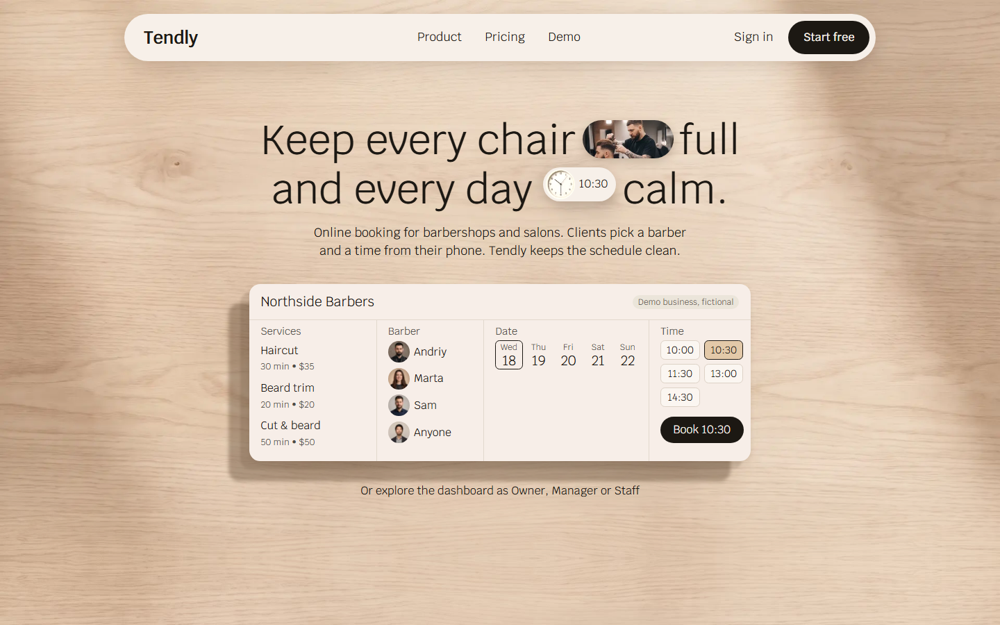
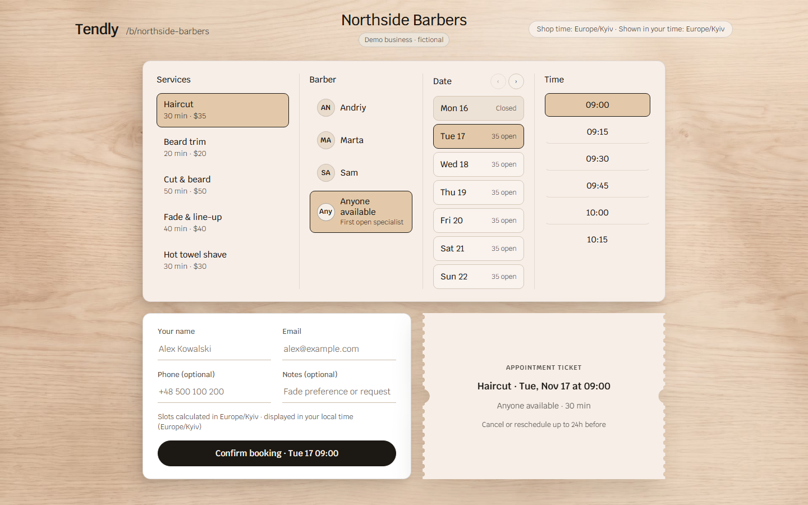
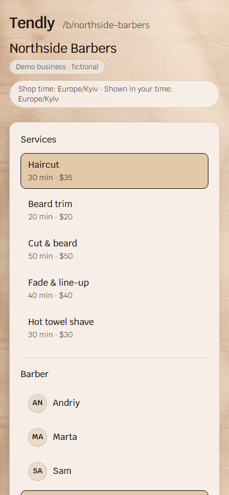
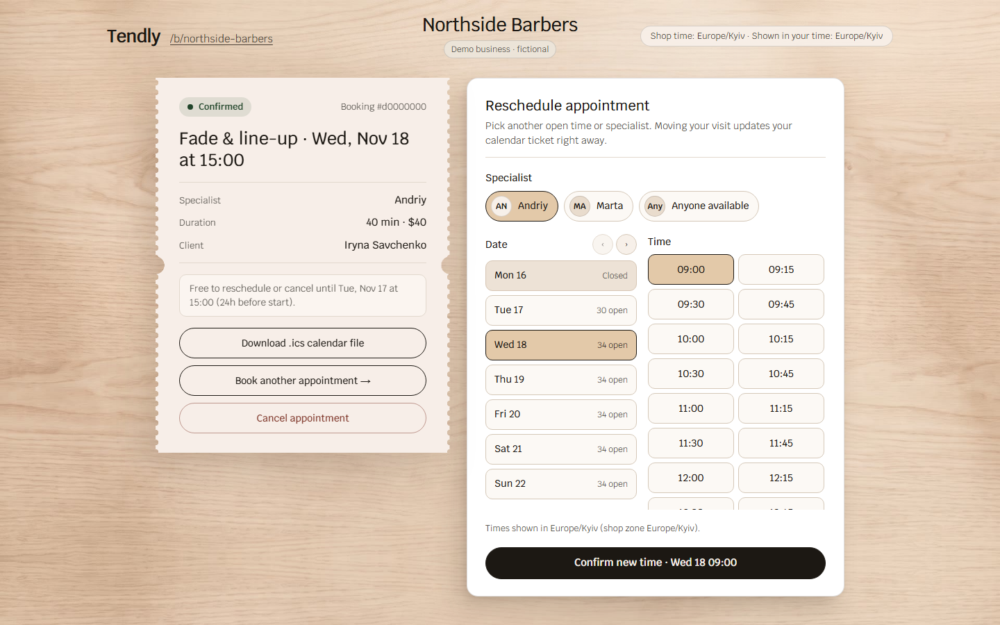
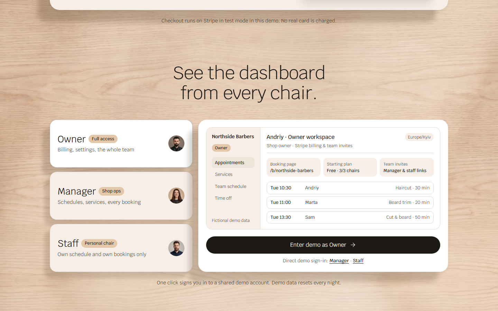
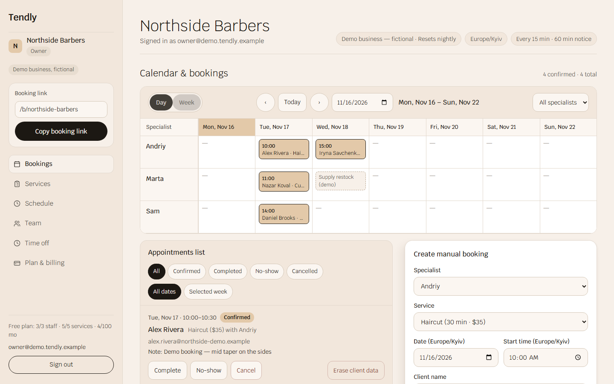
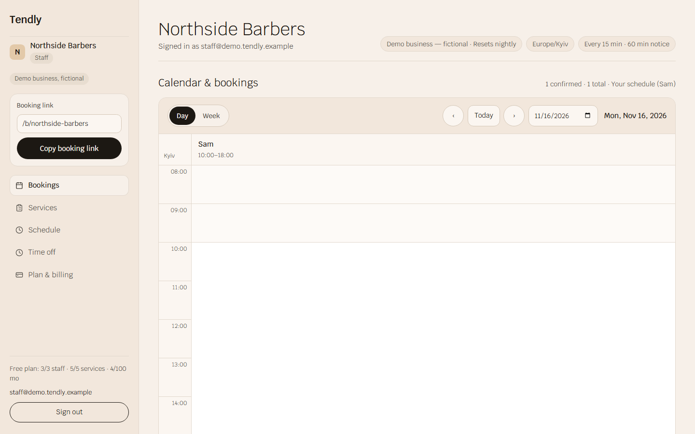
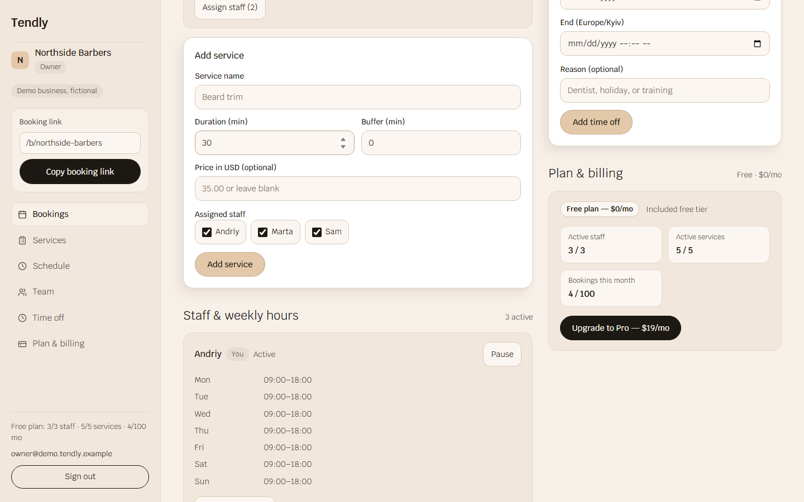

# Tendly — SaaS онлайн-бронювання для малого бізнесу

**Живе демо:** https://tendly-booking.vercel.app  
**Публічний запис демо-барбершопу:** https://tendly-booking.vercel.app/b/northside-barbers  
**Код:** https://github.com/ElVaddy-lab/tendly-booking  
**Швидкий вхід за ролями:** `/demo/owner` · `/demo/manager` · `/demo/staff`

> Демо-стенд: барбершоп *Northside Barbers*, майстри, послуги та стартові записи — вигадані. Оплата працює виключно у **Stripe Sandbox (test mode)** тестовою карткою `4242 ...`. Реєстрація відвідувачів працює без підтвердження email, створені бізнеси й акаунти старші за 24 год видаляються, а демо-дані скидаються щоночі (`02:55` / `03:00 UTC`).

## Навіщо

Запити формату *«побудувати MVP системи запису на Next.js + Supabase + Stripe»* зазвичай ламаються не на верстці, а в чотирьох місцях: переходи на літній/зимовий час (DST), подвійне бронювання при паралельних запитах, діряві перевірки прав на сервері й фейкові підняття тарифу по редіректу після оплати. **Tendly** показує, як усі чотири задачі вирішуються на рівні бази даних і серверної архітектури, при цьому даючи клієнту чистий запис у 3–4 кроки.

## Що вміє продукт

### Публічна сторінка запису (`/b/[slug]`)
- 4-колонкова дошка: послуга (тривалість, буфер після, ціна) → майстер або «Anyone available» → дата зі справжньою наявністю → слоти у часовому поясі відвідувача (автовизначення IANA-поясу браузера + контекст поясу закладу).
- Слоти рахуються динамічно функцією Postgres `available_slots()` із локальних змін (`weekly_hours`), винятків (`time_off`) і активних бронювань; ніколи не зберігаються наперед.
- Після підтвердження клієнт отримує перфорований квиток із файлом `.ics` для календаря та приватне посилання `/manage/[token]`.

### Самостійне керування записом (`/manage/[token]`)
- Токен зберігається в БД лише у вигляді SHA-256-хешу; публічна сторінка не світить персональні дані клієнта.
- Перенесення часу чи майстра працює через `private.available_slots_excluding()` — власний поточний запис не блокує суміжні слоти, а вимога дедлайну (`cancellation_deadline_hours`) та вікно актуальності контролюються в Postgres.
- Скасування миттєво повертає слот у розклад.

### Адмінка за ролями (`/dashboard`)
- Вхід в один клік із блоку `#roles` або через `/demo/owner`, `/demo/manager`, `/demo/staff`:
  - **Owner:** білінг Stripe, налаштування, запрошення команди з ролями (`/invite/[token]`), послуги, розклади, записи.
  - **Manager:** послуги, графіки всіх майстрів (з перервами/спліт-змінами), `time off`, календар і статуси, ручні walk-in записи.
  - **Staff:** лише власні бронювання, власний розклад і власна інтеграція (Telegram / `.ics`-підписка).
- Календар день / тиждень по працівниках, фільтрований список зі зміною статусів (`confirmed → completed / no_show / cancelled`), ручний запис без email, двокрокове GDPR-видалення даних клієнта.

### Сповіщення та білінг (Telegram + `.ics` + Stripe Sandbox)
- Персонал прив'язує Telegram одноразовою командою `/start <код>` через вебхук `/api/webhooks/telegram`; тригери ставлять події в `notification_outbox`, а `pg_cron` + `pg_net` дренують чергу кожні 5 хв через `/api/cron/reminders`. Кожен майстер має відкличну `.ics`-підписку (`/api/cal/[token]`).
- **Тарифи Free ($0) і Pro ($19/міс у Stripe Sandbox):**
  - `Free`: до 3 активних майстрів, 5 послуг і 100 записів/міс (демо стартує саме на Free з 3/3 і 5/5).
  - `Pro`: до 10 майстрів, безліміт послуг і записів, керування через Stripe Customer Portal.
  - Підняття й даунгрейд відбуваються **тільки** через підписаний вебхук `/api/webhooks/stripe` із дедуплікацією в `stripe_events` та перечитуванням підписки зі Stripe API; ліміти примушуються тригерами в Postgres.

## Ключові технічні рішення (ADR)

1. [Часові пояси й DST](../docs/adr/001-timezones-and-dst.md) — запис у `timestamptz` (UTC), шаблони змін локально (`weekly_hours`), перерахунок через `AT TIME ZONE` IANA-поясу бізнесу.
2. [Обчислення слотів і неможливість подвійного бронювання](../docs/adr/002-booking-conflicts-and-slots.md) — збережена колонка `blocked_until` (бо `timestamptz + interval` не `IMMUTABLE`) + `btree_gist` exclusion constraint на `(staff_id, tstzrange(starts_at, blocked_until, '[)'))`.
3. [Білінг Stripe Sandbox і ліміти в БД](../docs/adr/003-stripe-billing-and-limits.md) — відмова від client/redirect-апгрейдів, сирий підпис вебхука + канонічний `subscriptions.retrieve` + DB-тригери квот.

## Стек

Next.js 16.4.6 (App Router, Cache Components, `proxy.ts`), React 19, TypeScript, Tailwind CSS 4, CSS Modules, lucide-react · Supabase (Postgres, Auth SSR, RLS, pgTAP, `pg_cron`, `pg_net`) · Stripe Sandbox SDK & webhooks · Telegram Bot API · Vercel · Vitest, Playwright, axe-core.

## Виміряна якість

- **База даних (pgTAP):** 13 тест-сьютів, **278 перевірок** (`supabase db lint` — 0 помилок), включно з DST у Києві та Нью-Йорку, RLS-ізоляцією ролей, білінг-лімітами й демо-блокуваннями.
- **Unit-тести (Vitest):** 14 файлів, **105 тестів** (логіка слотів, DST, `.ics`, Stripe-вебхуки, `verifyCronSecret`, демо-режим).
- **E2E + Доступність (Playwright + axe-core):** **30 тестів** на десктопі та мобільному (`390×844`), зокрема одночасна гонка двох вкладок (`Promise.all`), вебхуки Stripe Sandbox, Telegram/`.ics` й обмеження `Owner / Manager / Staff` — **0 порушень WCAG 2.2 AA**.
- **Lighthouse 13.6 (PageSpeed Insights, живий `/`, 2026-11-16):** `mobile` Performance `99`, Accessibility `100`, Best Practices `100`, SEO `100`; `desktop` — `100` в усіх чотирьох категоріях. На живому продакшні `https://tendly-booking.vercel.app` підтверджено відсутність console/hydration помилок після виправлення вкладення форми у `#roles`.

## Чесно про демо

- Усі імена, фото/текстури, послуги й записи *Northside Barbers* вигадані. Відгуків, клієнтів чи метрик виручки немає.
- Платежі працюють лише у Stripe Sandbox (тестовий режим); реальні списання вимкнені.
- Публічна реєстрація у демо відкрита без підтвердження email, тому скидання пароля немає, а гостьові дані автоматично видаляються через 24 год.
